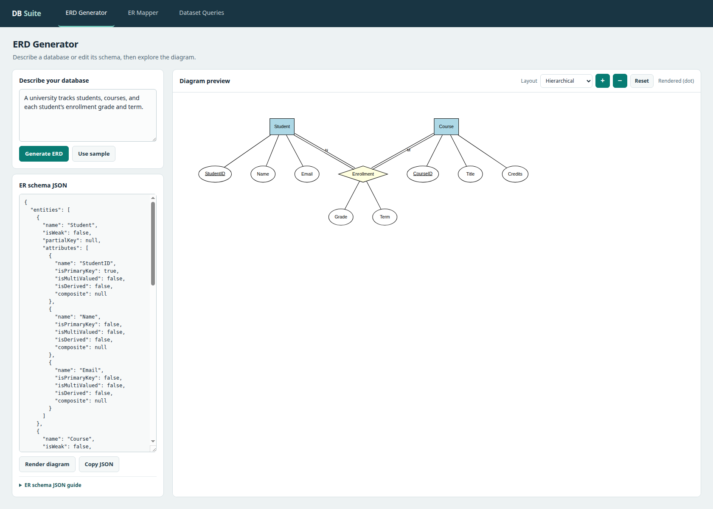
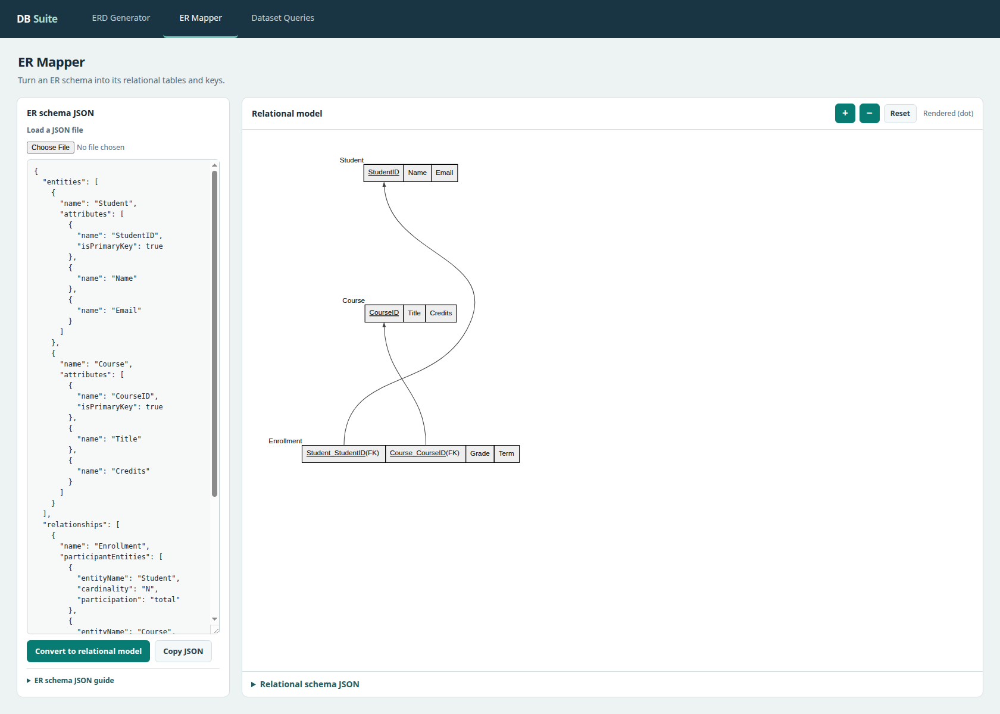
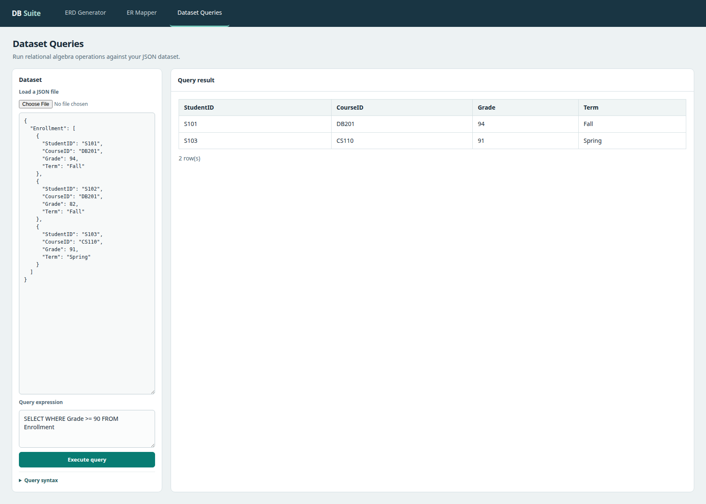

# DB Suite

DB Suite is a small web app for working through a database design workflow. Create an entity relationship diagram (ERD), convert the schema into relational tables, then try relational algebra queries against sample data.

DB Suite was developed for a database course. It brings the course's ERD, mapping, and query tools together in one web app.

## What you can do

- **ERD Generator:** describe a database in plain language and generate an ER schema, or paste schema JSON and render it.
- **ER Mapper:** convert an ER schema into relational tables, keys, and relationships.
- **Dataset Queries:** run relational algebra expressions against JSON tables and inspect the results.

## Examples

These screenshots use a university schema with students, courses, and enrollments. The same example moves through ERD design, relational mapping, and a query for grades of 90 or higher.

### ERD Generator



### ER Mapper



### Dataset Queries



## Run locally

You need Python 3.10 or newer. The ERD Generator uses a Gemini API key. The other tools work without one.

```bash
python3 -m venv .venv
source .venv/bin/activate
python -m pip install -r requirements.txt
cp .env.example .env
```

Add your Gemini API key to `.env`:

```dotenv
GEMINI_API_KEY=your_gemini_api_key
```

Then start the app:

```bash
python app.py
```

Open [http://127.0.0.1:5000](http://127.0.0.1:5000).

On Windows, activate the environment with `.venv\Scripts\activate` instead of the `source` command.

## Requirements and notes

- `GEMINI_MODEL` is optional. If unset, DB Suite uses its configured default model.
- The ERD Generator needs internet access to call Gemini. The diagram preview also loads Viz.js from a CDN.
- Local PNG export needs Graphviz installed, including the `dot` executable. The rest of the app can run without it.
- Keep `.env` private. It is ignored by Git; use `.env.example` to document environment variable names.

## Guides

- [ERD generation and notation](docs/erd-generation.md)
- [Relational mapping and dataset queries](docs/relational-modeling-and-queries.md)
- [Query language grammar](docs/query-language-grammar.md)

## Project layout

```text
app.py                  Flask application entry point
index.html              Shared DB Suite interface
dbsuite/
  erd/                  ER schema generation and drawing
  relational/           ER mapping and query execution
docs/                   User guides, grammar, and screenshots
requirements.txt        Python dependencies
```
